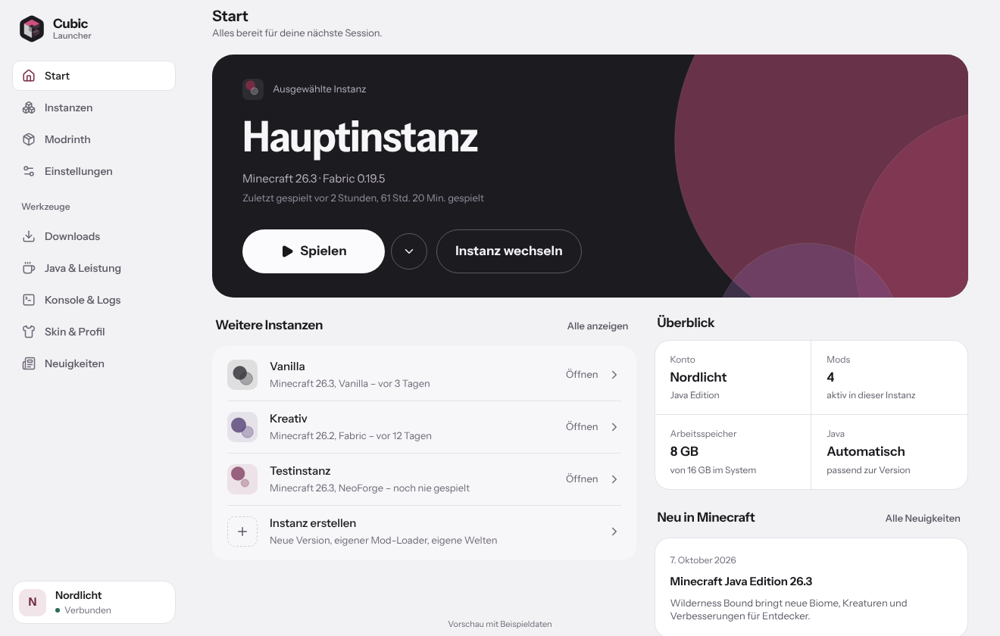
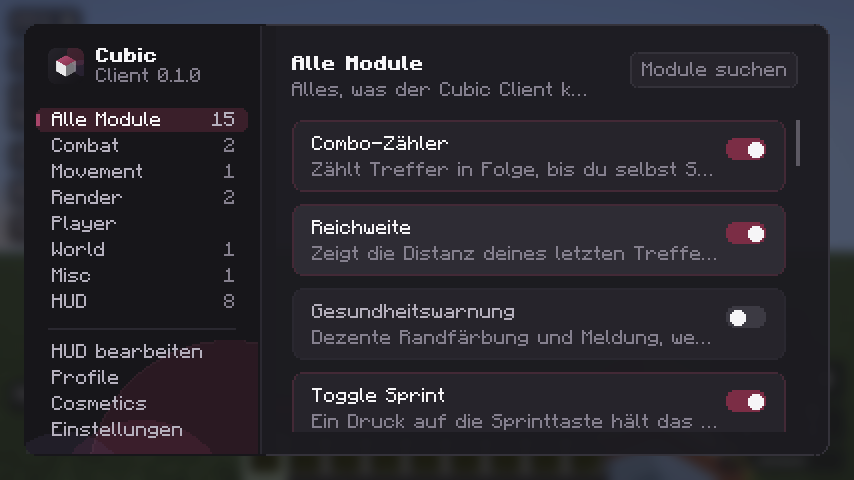
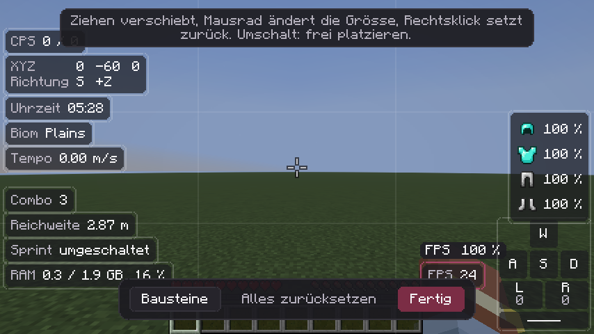
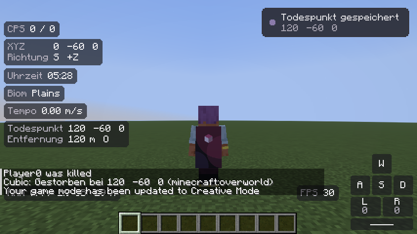
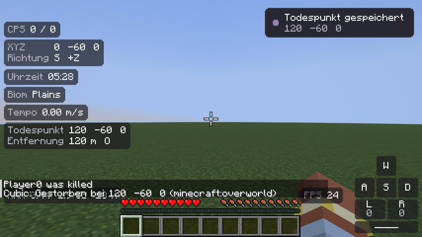
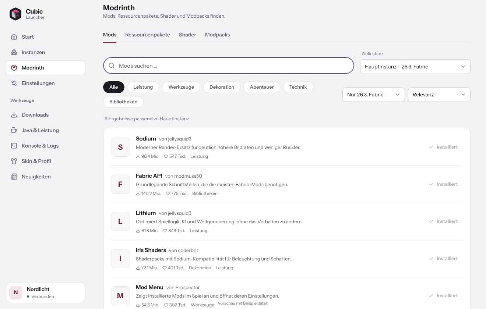
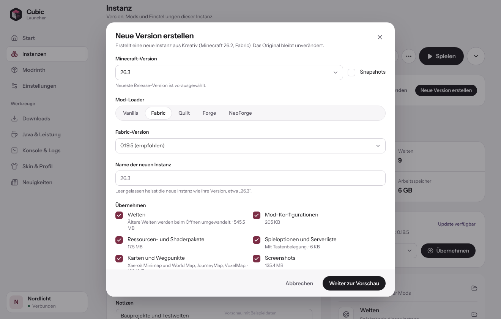

# Cubic

**Cubic is a Minecraft: Java Edition launcher and a companion client mod, built to work as one product.**
Instead of combining a third-party launcher, a mod manager, a separate HUD/minimap mod, a cosmetics mod and a migration tool, players get one launcher and one client with a shared design and settings.

> **Status: in development, no public download yet.**
> Cubic is being finished as a private Windows release. Release builds will be published on the [Releases](../../releases) page of this repository once they are ready. The interface is available in German and English (screenshots below show the German UI).

## What Cubic consists of

### Cubic Launcher (Windows)

Desktop app built with Tauri 2, React 19, TypeScript and a Rust core.

- Installs and launches Minecraft versions, including the Java runtime, libraries, assets and natives
- Any number of independent instances with their own mods, configs and worlds
- Fabric, Quilt, Forge and NeoForge with selectable loader versions
- Microsoft sign-in through the official OAuth flow (PKCE, device code as fallback), multiple accounts, skins and capes
- Built-in Modrinth browser for mods, resource packs, shaders and modpacks, with compatibility checks, dependency resolution, conflict detection and one-click updates with backup
- Pre-launch check that reads Fabric's `depends`/`breaks`/`conflicts` rules and offers concrete fixes
- Moves an instance to a new Minecraft version as a separate copy: matching mod versions are looked up on Modrinth, Java is adjusted, and missing mods or conflicts are listed for later review. A preview shows what will happen first
- Import from Prism, CurseForge, the Modrinth App and the official launcher; `.mrpack` import and export; backups and a recycle bin
- Java detection and installation, RAM recommendations, console, logs, crash reports with automatic diagnosis
- Light and dark appearance, German and English

### Cubic Client (Fabric mod for Minecraft 26.3)

- Module system with 25 modules in seven categories (Combat, Movement, Render, Player, World, Misc, HUD)
- Cubic menu with search, per-module settings and key bindings
- Drag-and-drop HUD editor with snapping and scaling
- Minimap and world map with waypoints and death marker
- Profiles (PvP, Performance, Vanilla, Survival and custom ones)
- Capes and cosmetics, visible to other Cubic players through a self-hostable cosmetics server
- Performance options (dynamic FPS, performance mode); tested together with Sodium, Lithium and Iris
- German and English, following the game language

### Fair play by design

No module changes reach, hit detection, movement, input or network packets. Modules display information, count events or change rendering. A dedicated automated test checks that the client's hooks stay limited to display, counting and zoom code.

## Screenshots

The client screenshots are taken automatically by game tests running in real Minecraft 26.3.

| Cubic menu | HUD editor |
| --- | --- |
|  |  |

| Cape in game | Death marker on the map |
| --- | --- |
|  |  |

| Modrinth browser | Version upgrade preview |
| --- | --- |
|  |  |

## How it is built and tested

- Rust core (downloads, installation, launch, accounts, Modrinth, migration), Tauri desktop shell, React interface
- Cubic Client as a Fabric mod in Java 25, written against the unobfuscated Minecraft 26.x code
- Cosmetics server in Rust with a Docker image (amd64 and arm64, runs on a Raspberry Pi)
- Automated tests on every level: Rust unit and integration tests, Vitest, Playwright end-to-end tests, JUnit, client game tests inside real Minecraft, and an install/uninstall test of the Windows installer on a GitHub Actions Windows runner

## Download and installation

There is no public release yet. When the first release is published here, it will contain:

- the Windows installer (NSIS or MSI)
- an installation guide
- release notes and SHA-256 checksums for every file

The launcher installs the Cubic Client into an instance automatically; no manual mod installation is needed.

Requirements: Windows 10 or 11 (64-bit) and a Minecraft: Java Edition account. Cubic signs in only through Microsoft's official login and does not work without a valid Minecraft license.

## Feedback

Questions and bug reports are welcome as [issues](../../issues) in this repository.

---

Cubic is an independent, unofficial project. It is not affiliated with, endorsed by or associated with Microsoft or Mojang Studios. Minecraft is a trademark of Mojang Studios.
